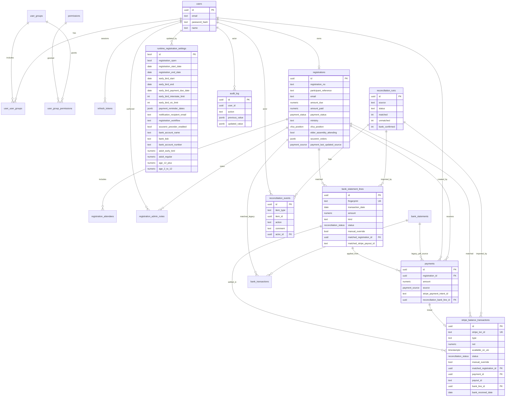

# Data model

Spec: `global.database`. Schema evolves only via numbered migrations in `supabase/migrations/`.

## Entity relationship (simplified)

## Important registration fields

| Field | Role |
|-------|------|
| `registration_no` | Display / alternate payment match |
| `participant_reference` | **Unique Code** for bank Message/Ref |
| `souvenir_orders` | `[{ size, quantity }, …]` t-shirts |
| `pickup_*` / `dropoff_*` | Transport flags + admin contacts |
| `hotel_name` / `hotel_address` | UI: Accommodation name/address |
| `runtime_registration_settings` | Admin runtime controls for registration open/close, early bird window, and pricing |
| `ministry` / `cfca_position` | Ministry and Ministry Role; Non-member ministry requires Non-member role |
| `elder_assembly_attending` | Attendance response shown for eligible leadership roles |
| `view_token_hash` / signup tokens | Magic link + account link |

## Reconciliation tables (migration 025)

| Table | Role |
|-------|------|
| `reconciliation_runs` | One row per upload / re-check (counters, file SHA-256, error); `processing` acts as a 10-minute run lock |
| `stripe_balance_transactions` | Stripe balance history rows, unique by `stripe_txn_id`; status + match + admin override fields; bank settlement (`payout_id`, `bank_line_id`, `bank_received_date`) recomputed after every run (migration 026) |
| `bank_statement_lines` | CBA CSV lines, unique by `fingerprint`; `kind` = transfer / stripe_payout / debit |
| `reconciliation_events` | Activity log per row and run (from/to status, amount, comment, actor) |
| `payments.reconciliation_bank_line_id` | Payment applied (positive) or reversed (negative) from a bank line |

Status enum `reconciliation_status`: `matched`, `unmatched`, `ignored`, `not_applicable`. FK direction is `payments → bank_statement_lines` only (no cycles, required by the backup tool). See `features.payment-reconciliation`.

## Registration backups (migration 027)

| Table / object | Role |
|-------|------|
| `registration_backups` | One row per Melbourne day (`backup_date` unique): `processing` claim → `completed` with `file_path`, `file_name`, `size_bytes`, `registration_count`, `file_sha256`, `created_by` (FK users, `ON DELETE SET NULL`) |
| Storage bucket `registration-backups` (private) | `YYYY/registrations-backup-YYYY-MM-DD.zip`, one detailed registrations CSV inside |
| Permission `backups:manage` | Admin group only |

See `features.registration-backups`.

## Groups (seeded)

`admin`, `registration_manager`, `accommodation_manager`, `participant` — see `001_auth.sql`.

## When adding columns

1. New file `supabase/migrations/0xx_name.sql`
2. Update `specs/global/database.md`
3. Update this ER if relationships change
4. Update Zod / `mapFormToDb` / compare snapshots as needed
5. Never edit applied migrations on shared environments
