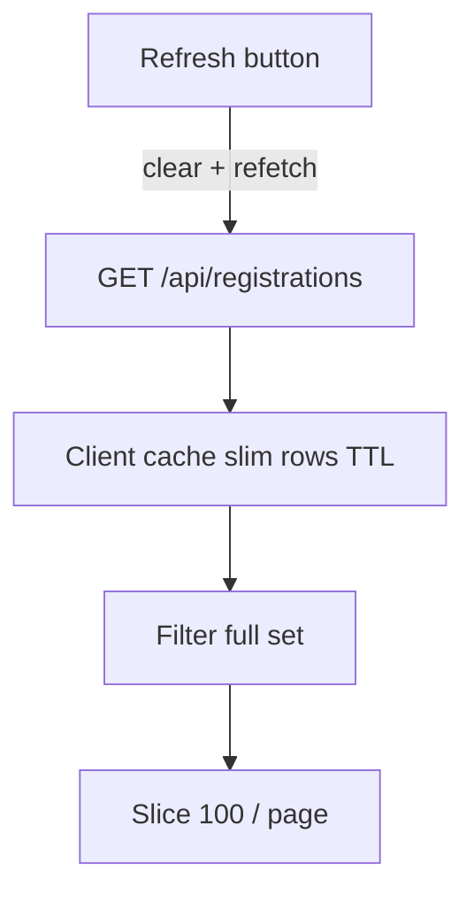
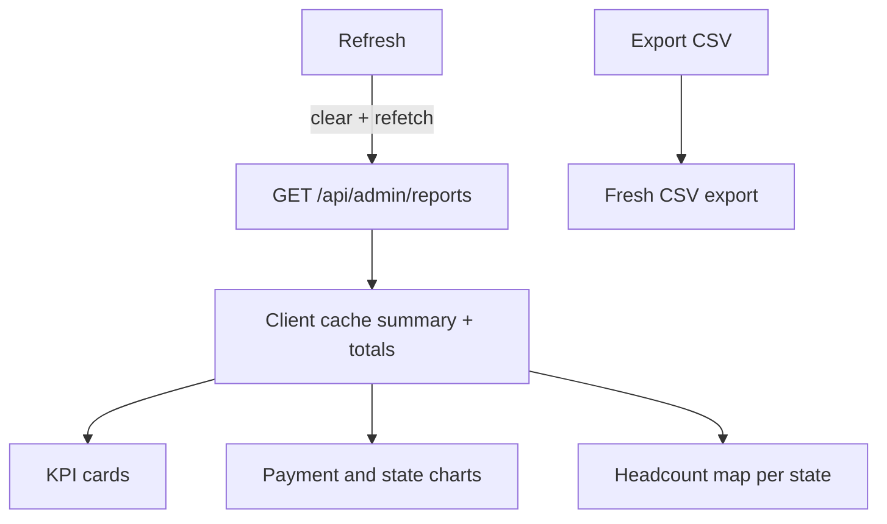
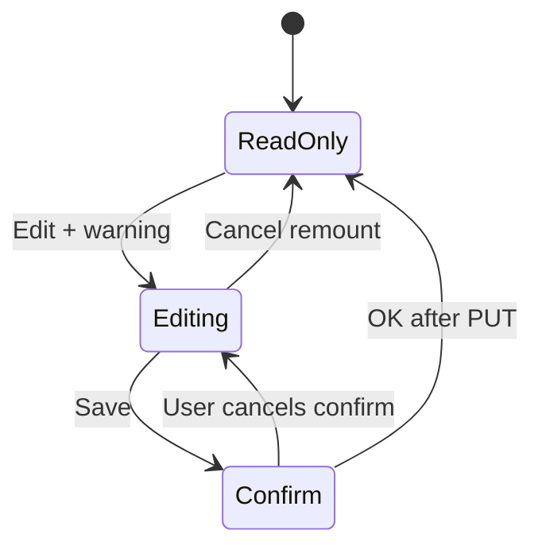
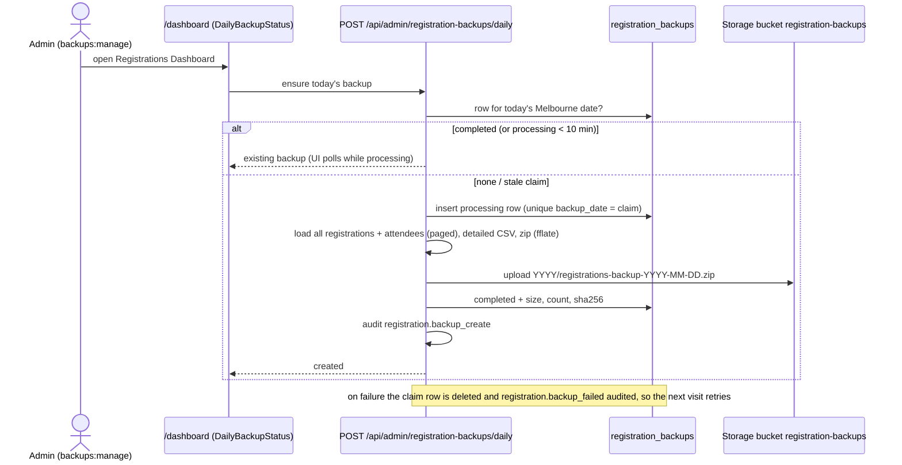

# Admin dashboard flows

Specs: `features.dashboard`, `features.audit`, `features.registration-backups`.

## List + filters + paging



Filters (full dataset): payment, accommodation, transpo, state, souvenir pre-order, text search.

## Reports overview



Reports UI: welcome panel, payment donut, registrations-by-state bar chart, people composition, per-state headcount map, Early Bird Registration Report (KPI cards, per-group donuts, per-state stacked bars, client-side CSV export; figures derived in `src/lib/dashboard/early-bird-report.ts` from the cached `earlyBird` payload).

The headcount map (`StateHeadcountMap`) is pure client rendering from the cached `summary`: `buildStateHeadcounts` sums all attendees per state split into adults (18+), teens (12–17), kids (2–11) and infants (0–1) from the summary's `teens` / `children` / `infants` fields, and the total card is the sum of the states. The Adults / Kids / Teens checkboxes are local component state (`HeadcountSelection`, default `ALL_SELECTABLE_BANDS`; all three ticked = everyone incl. infants); `headcountForSelection` / `bandsForSelection` derive the numbers, and a single selected group switches to the compact single-number card layout, and the "as of" date is the cache entry's `fetchedAt` in Melbourne time. State outlines are static SVG paths in `src/lib/dashboard/australia-states-map.ts`, generated once by `npx tsx scripts/maps/generate-australia-states.ts` from Natural Earth 1:50m admin-1 boundaries (public domain; Lambert conformal conic projection). Re-run the script only to change resolution or label anchors; callout box positions live in the component.

## Registration detail



Sections: Registration Info → Payment → Attendees → Accommodation → Transportation → **Admin notes** (bottom).

## Audit log

```mermaid
flowchart LR
  Action[Mutation] --> Write[writeAuditLog]
  Write --> Table[(audit_log)]
  Table --> UI[/dashboard/audit]
```

Empty registration updates should **not** write rows (no-op guards).

## Daily registration backup



`/dashboard/backups` lists `GET /api/admin/registration-backups`; **Download** streams `GET /api/admin/registration-backups/[id]/download` (audited `registration.backup_download`). The bucket is private; files only leave through that route.

## Permissions cheat sheet

| Capability | Typical permission |
|------------|-------------------|
| See dashboard | manager group |
| Edit all registration fields | `registrations:write_all` |
| Edit accommodation/transport | `accommodation:write_all` |
| Reconcile / manual payment | `payments:reconcile` (and/or write_all) |
| Users + audit UI | `users:manage` |
| Daily backups (create on visit, list, download) | `backups:manage` (admin) |

## Navigation submenu

```mermaid
flowchart LR
  Header[Header Dashboard dropdown]
  Subnav[DashboardSubnav on /dashboard pages]
  Header --> Reg[/dashboard]
  Header --> Reports[/dashboard/reports]
  Header --> Recon[/dashboard/payments/reconcile]
  Header --> Users[/dashboard/users]
  Header --> Audit[/dashboard/audit]
  Header --> Backups[/dashboard/backups]
  Subnav --> Reg
  Subnav --> Reports
  Subnav --> Recon
  Subnav --> Users
  Subnav --> Audit
  Subnav --> Backups
```

Role editor: Users page → Edit roles → `PATCH /api/admin/users` → audit `user.update` + revoke sessions.

## Key files

- `src/components/layout/dashboard-subnav.tsx`
- `src/components/layout/site-header.tsx`
- `src/components/dashboard/stat-card.tsx`
- `src/components/dashboard/welcome-panel.tsx`
- `src/components/dashboard/dashboard-panel.tsx`
- `src/app/dashboard/page.tsx`
- `src/app/dashboard/reports/page.tsx`
- `src/app/dashboard/users/page.tsx`
- `src/lib/auth/user-groups.ts`
- `src/lib/dashboard/registrations-list-cache.ts`
- `src/lib/dashboard/reports-cache.ts`
- `src/components/dashboard/state-headcount-map.tsx`, `src/lib/dashboard/state-headcount.ts`, `src/lib/dashboard/australia-states-map.ts`
- `src/app/dashboard/registrations/[id]/page.tsx`
- `src/app/dashboard/audit/page.tsx`
- `src/app/dashboard/backups/page.tsx`, `src/components/backups/daily-backup-status.tsx`, `src/lib/backups/*`
