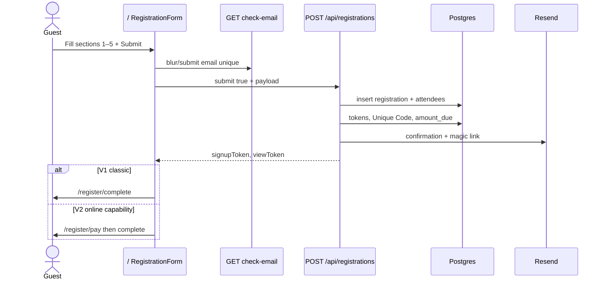
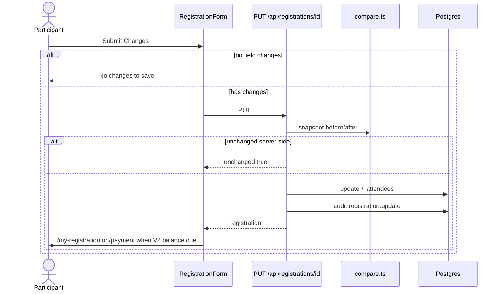
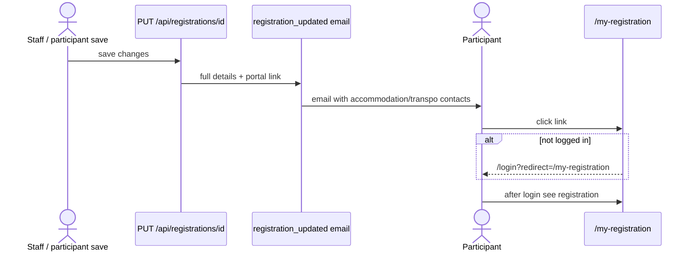
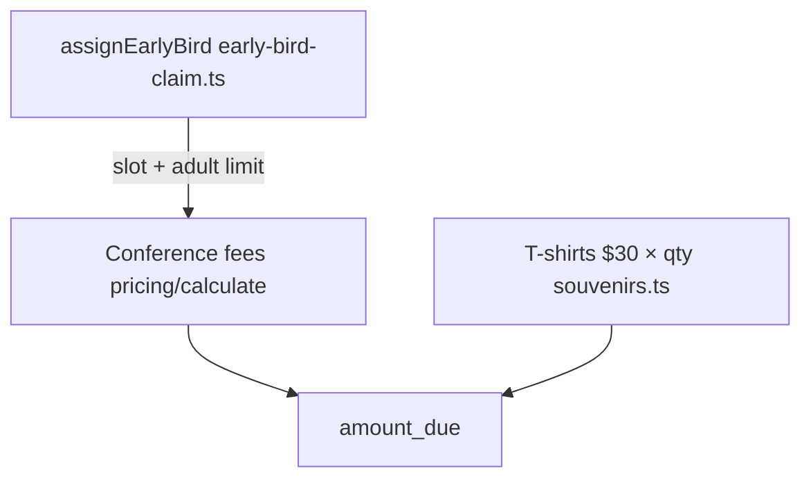
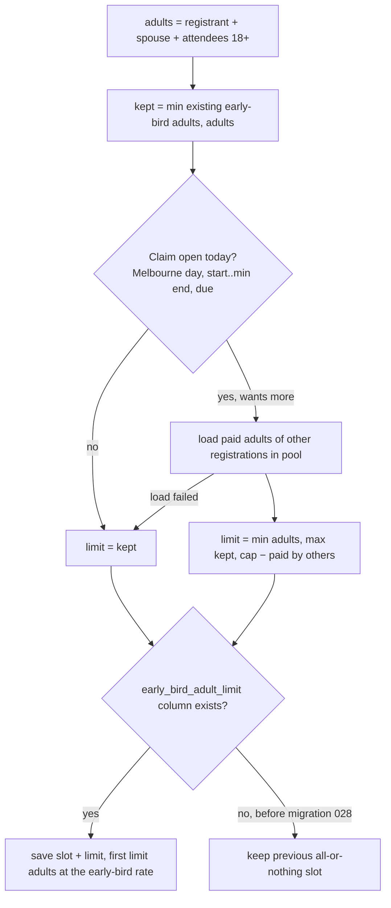

# Registration flows

Specs: `features.registration`, `features.registration-complete`, `features.registration-workflow-v2`, `features.magic-link-view`, `features.home`.

## Continuous form (guest)

Workflow comes from Dashboard Settings (`registration_workflow`, default **v1**). Preview V2 without flipping Settings: `/?workflow=v2`.



## Logged-in update



## Magic link view

```mermaid
flowchart LR
  Email[Confirmation email] -->|/r/token| View[Read-only page]
  View -->|Edit| LoginOrSignup{Has account?}
  LoginOrSignup -->|yes| Login[/login]
  LoginOrSignup -->|no| Signup[/signup?email=]
  View -->|Balance due > 0| Pay[/register/pay?view=token]
  Pay -->|Stripe success / bank continue| View
```

## Update notification email



## Amount due composition



## Early bird claim (submit / edit)

Rules: `features.registration` → "Early bird is per adult". Runs in `POST /api/registrations` (submit) and `PUT /api/registrations/[id]` (first submit, or edit of a registration that already has early bird).



Unpaid early-bird adults are later moved to the regular rate by the daily cron (`docs/flows/payment.md` → Daily payment reminders and early-bird expiry).

## Key files

| Concern | Path |
|---------|------|
| UI | `src/components/registrations/registration-form.tsx` |
| Zod | `src/lib/registrations/schema.ts` |
| Persist | `src/lib/registrations/service.ts` |
| No-op detect | `src/lib/registrations/compare.ts` |
| Public/auth POST | `src/app/api/registrations/route.ts` |
| Early bird counting / dates / wording | `src/lib/pricing/early-bird.ts` |
| Early bird claim | `src/lib/registrations/early-bird-claim.ts` |
| Early bird expiry | `src/lib/registrations/early-bird-expiry.ts`, `early-bird-expiry-runner.ts` |

## Debug tips

- Email already used → `EMAIL_IN_USE` + Login link
- Amount wrong → check `is_early_bird`, `early_bird_slot`, `early_bird_adult_limit` (adults on early bird; `NULL` = all), attendee ages and souvenir_orders JSON
- Early bird missing on a new registration → pool full of paid adults, or submitted after the claim end date (Melbourne day)
- Empty audits → ensure no-op path; see compare + PUT early return
